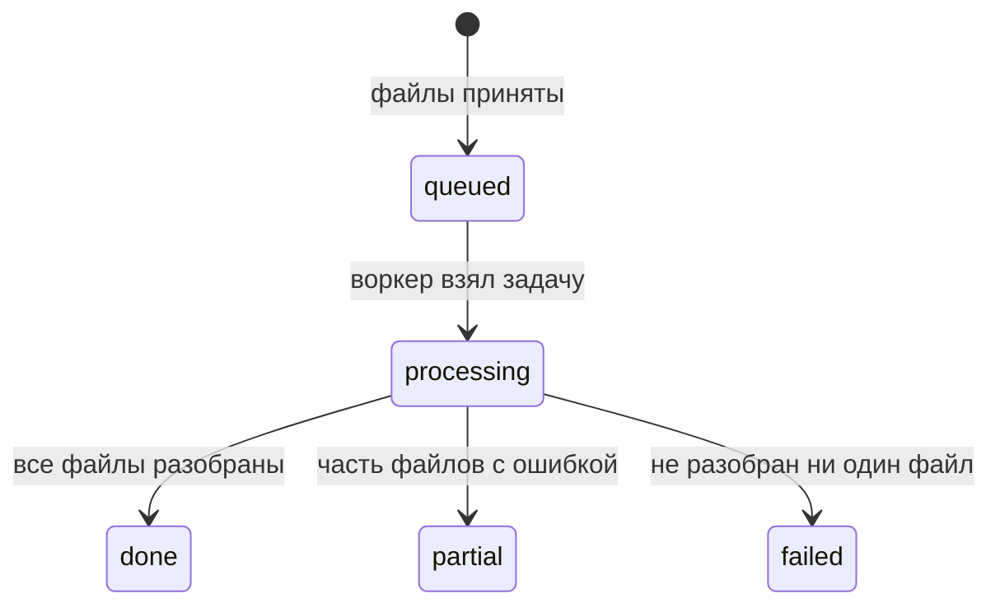

# Аналитика: скоринг закупок (AI Procurement Copilot)

Приоритеты P0 / P1 / P2 и сроки — в `CLAUDE.md` и `docs/plan.md`; они главнее этого документа: функции P2 не делать, пока не готово всё P0 и P1.

## Назначение, пользователи, глоссарий

Система помогает поставщику за минуты отобрать из пачки закупок ЕИС те, в которых стоит участвовать, и объясняет почему. Решение принимает человек: система только оценивает и рекомендует.

**Пользователь.** Тендерный специалист или менеджер по продажам компании-поставщика. Знает закупки, но не программист. Работает в браузере на ноутбуке, иногда смотрит результаты с телефона. Пользователи входят по логину и паролю; у каждого свои профили скоринга и загруженные закупки, несколько человек работают одновременно (раздел «Пользователи и доступ»).

**Основные сценарии:**

1. Настроить профиль скоринга: описать текстом интересные закупки, проверить и поправить правила.
2. Загрузить пачку закупок и дождаться обработки.
3. Просмотреть результаты, отсортировать по оценке, открыть карточку и понять причину оценки.
4. Изменить параметры и пересчитать оценку без повторной загрузки.
5. Выгрузить результаты в CSV/JSON.

**Глоссарий**

| Термин | Значение |
| --- | --- |
| ЕИС | Единая информационная система в сфере закупок, zakupki.gov.ru |
| Извещение | Документ, объявляющий закупку; основной входной файл |
| Реестровый номер | Уникальный номер закупки в ЕИС (для 44-ФЗ — 19 цифр) |
| НМЦК | Начальная (максимальная) цена контракта |
| Способ закупки | Электронный аукцион, конкурс, запрос котировок и т. д. |
| ОКПД2 | Классификатор продукции по видам деятельности; коды предмета закупки |
| ОКВЭД | Классификатор видов экономической деятельности организации |
| Заказчик | Организация, проводящая закупку; оценивается его надёжность |
| Поставщик | Пользователь системы; компания, которая решает, участвовать ли |
| Профиль скоринга | Набор правил и весов одного поставщика |
| Правило | Условие на поле закупки или заказчика с весом |
| Стоп-фактор | Правило, при срабатывании которого оценка обнуляется |
| Группа | Одна из трёх групп критериев: закупка, соответствие, заказчик |

## Нефункциональные требования

| ID | Требование | Значение | Источник |
| --- | --- | --- | --- |
| NFR-1 | Время оценки одной закупки (парсинг + ЕГРЮЛ + скоринг + обоснование) | < 10 с, цель < 5 с | ТЗ, критерий 4 |
| NFR-2 | Пакетная обработка | 100 закупок < 3 мин, без 504 при любом размере пакета | ТЗ, общие требования |
| NFR-3 | Ответ любого синхронного эндпоинта | < 2 с; всё тяжёлое — через очередь | ТЗ, общие требования |
| NFR-4 | Размер загрузки | один файл до 20 МБ, архив до 100 МБ, до 500 файлов в пакете |  |
| NFR-5 | Воспроизводимость | одинаковые входные данные и профиль дают одинаковую оценку | ТЗ, критерий 6 |
| NFR-6 | Работа без внешних сервисов | без LLM-ключа и без сети к DaData система считает оценку (шаблонные обоснования, кэш/офлайн-профили) |  |
| NFR-7 | Запуск | `docker-compose up --build` на чистой машине, без ручных шагов кроме `.env` | ТЗ, критерий 7 |
| NFR-8 | Удобство | новый пользователь проходит основной сценарий без инструкции за 3 мин | ТЗ, общие требования |
| NFR-9 | Язык интерфейса | русский; суммы в рублях с разделителями разрядов; даты ДД.ММ.ГГГГ | Общие требования |
| NFR-10 | Секреты | ключи только в `.env`, в репозитории только `.env.example` | Общие требования |
| NFR-11 | Логирование | каждый файл и каждый внешний вызов логируются с task\_id; ошибки видны в интерфейсе | Общие требования |

## Пользователи и доступ

Авторизация нужна, чтобы несколько человек работали одновременно и не видели данные друг друга. Менторы назвали её необязательной, но при равных баллах это плюс.

- Регистрация по логину (e-mail) и паролю; пароль хранится только как хэш bcrypt.
- Вход выдаёт JWT в httpOnly-cookie, срок жизни 12 часов; выход очищает cookie.
- Одна роль пользователя, без админки.
- Изоляция: у `ScoringProfile`, `Procurement`, `ScoreResult` и `Task` есть `owner_id`, каждый запрос фильтрует по текущему пользователю. Чужая запись → 404, а не 403, чтобы не раскрывать её существование.
- Общие для всех данные: кэш ЕГРЮЛ (`CustomerProfile`) и справочники — это публичные сведения.
- Одна и та же закупка у двух пользователей — две записи: оценки зависят от профиля.
- При старте создаётся демо-пользователь с готовым профилем и примером закупок; логин и пароль берутся из `.env` и указываются в README.
- Эндпоинты: `POST /api/auth/register`, `POST /api/auth/login`, `POST /api/auth/logout`, `GET /api/auth/me`; все остальные требуют входа.
- В интерфейсе: экран входа и регистрации, имя пользователя и «Выйти» в шапке; без входа доступна только страница входа.

## Загрузка и фоновая обработка

Каждый файл пакета обрабатывается независимо: ошибка в одном не останавливает остальные. Синхронный запрос только принимает файлы и сразу возвращает `task_id`.

**Сценарий UC-2 «Загрузить закупки»**

1. Пользователь выбирает файлы `.xml`, `.json` или `.zip` с ними.
2. Система проверяет расширение и размер (NFR-4), сохраняет файлы, создаёт задачу со статусом `queued` и возвращает `task_id`.
3. Воркер распаковывает архивы и для каждого файла выполняет: парсинг → ИНН заказчика → профиль заказчика → оценка по активному профилю скоринга → обоснование.
4. После каждого файла обновляется прогресс N из M; фронт опрашивает `GET /api/tasks/{id}` раз в 1–2 с.
5. В конце задача переходит в итоговый статус (схема ниже), пользователь переходит к результатам.



Итоговый статус выбирается по результатам файлов; у каждого файла свой статус `ok` или `error` с кодом ошибки.

**Правила обработки**

- Дубли: закупка определяется реестровым номером; повторная загрузка обновляет запись (извещение могли изменить), а не создаёт вторую.
- Пересчёт: смена профиля скоринга пересчитывает оценки всех загруженных закупок без повторного парсинга и без повторных запросов в ЕГРЮЛ; тоже через очередь.
- Исходный файл сохраняется, чтобы переразобрать его после исправления парсера.

**Коды ошибок и реакция**

| Код | Когда | Файл | Текст для пользователя |
| --- | --- | --- | --- |
| UNSUPPORTED\_FORMAT | Не XML/JSON/ZIP или файл повреждён | error | «Файл не похож на выгрузку из ЕИС» |
| NOT\_A\_NOTICE | Валидный XML, но не извещение (протокол, контракт) | error | «Это не извещение о закупке» |
| MISSING\_REQUIRED\_FIELD | Нет обязательного поля (раздел «Парсер ЕИС») | error | «В файле не найдено: НМЦК» |
| CUSTOMER\_NOT\_FOUND | ИНН не найден в ЕГРЮЛ | ok | «Заказчик не найден в ЕГРЮЛ», группа «Заказчик» = нет данных |
| EGRUL\_UNAVAILABLE | DaData недоступна и нет кэша | ok | «Данные о заказчике временно недоступны» |
| LLM\_UNAVAILABLE | Нет ключа или провайдер не отвечает | ok | Обоснование собирается по шаблону, без сообщения об ошибке |

## Парсер ЕИС

Парсер превращает любое поддерживаемое извещение в одну и ту же структуру `Procurement`. Обязательных полей три: реестровый номер, предмет и НМЦК; без них оценка теряет смысл, остальные поля могут отсутствовать и тогда помечаются «нет данных».

**Распознавание документа**

- Решение не привязано к закону: поддерживаются любые извещения ЕИС (44-ФЗ, 223-ФЗ и прочие). Закон — информационное поле, а не условие работы парсера.
- Тип документа определяется по локальному имени корневого элемента, пространства имён игнорируются. Для известных типов — свои адаптеры, реестр адаптеров расширяемый.
- Неизвестный тип → **универсальный адаптер**: обходит всё дерево XML и ищет поля по словарю синонимов тегов (например, реестровый номер может называться `purchaseNumber` или `registrationNumber`). Словарь пополняется по собранным образцам.
- [P2] Если и универсальный адаптер не нашёл обязательные поля → извлечение через LLM из текстового содержимого документа, результат валидируется и помечается источником `llm`. Без LLM-ключа шаг пропускается.
- `NOT_A_NOTICE` возвращается, только если обязательные поля не найдены ни одним способом.
- Закон определяется по адаптеру, а для универсального — по формату реестрового номера и признакам в документе; не удалось → `other`.
- Точные пути тегов фиксируются в `docs/eis-fields.md`; на каждый адаптер — юнит-тест с эталоном.

**Поля `Procurement`**

| Поле | Тип | Обяз. | Что извлекаем | Нормализация |
| --- | --- | --- | --- | --- |
| reg\_number | строка | да | Реестровый номер извещения | Только цифры |
| law | enum | нет | Закон | `44`, `223`, `615`, `94`, `other` |
| subject | строка | да | Наименование объекта закупки | Обрезка пробелов, без HTML |
| nmck | число | да | НМЦК (начальная цена) | Decimal, рубли; иная валюта → поле currency и пометка |
| currency | строка | нет | Валюта | По умолчанию RUB |
| method | enum | нет | Способ определения поставщика | `auction`, `contest`, `quotation`, `proposals`, `single`, `other` |
| method\_raw | строка | нет | Способ закупки как в документе | Для отображения и нестандартных способов |
| customer\_inn | строка | нет | ИНН заказчика | 10 цифр (юрлицо), проверка контрольной суммы |
| customer\_name | строка | нет | Наименование заказчика | Для отображения до ответа ЕГРЮЛ |
| region | строка | нет | Субъект РФ места поставки | К справочнику субъектов РФ; нет места поставки → регион заказчика |
| delivery\_place | строка | нет | Место поставки текстом | Как есть |
| published\_at | дата-время | нет | Дата размещения | UTC |
| application\_deadline | дата-время | нет | Окончание подачи заявок | UTC; в интерфейсе — местное время |
| delivery\_term\_text | строка | нет | Срок поставки текстом | Как есть |
| delivery\_days | число | нет | Срок поставки в днях | Регулярные выражения по тексту; не вышло → пусто |
| okpd2\_codes | список | нет | Коды ОКПД2 позиций | Формат `XX.XX.XX.XXX`, без дублей |
| items | список | нет | Позиции: наименование, количество, единица, цена | Для карточки и семантики |
| bid\_security | число | нет | Обеспечение заявки, ₽ | Процент → в рубли от НМЦК, исходный процент хранится |
| contract\_security | число | нет | Обеспечение исполнения контракта, ₽ | Так же |
| restrictions | список | нет | Ограничения и преимущества | `smp_only`, `national_regime`, `prefs_uis`, `prefs_disabled`, `other` |
| source\_url | строка | нет | Ссылка на карточку в ЕИС | Собирается по реестровому номеру |
| parsed\_by | enum | да | Каким способом разобран | `adapter:<имя>`, `universal`, `llm` — показывается в карточке |

**JSON на входе.** ЕИС отдаёт XML, поэтому JSON — это наш собственный формат: та же структура `Procurement`, валидация Pydantic. Пригодится для тестов.

**Режимы закупок в ЕИС.** Кроме 44-ФЗ и 223-ФЗ в ЕИС размещаются закупки по ПП РФ № 615 (капитальный ремонт многоквартирных домов), а в архиве лежат закупки по старому 94-ФЗ. Поэтому поле `law` принимает значения `44`, `223`, `615`, `94`, `other`, а парсер ни от одного из них не зависит. Закупки по 94-ФЗ давно завершены и для поставщика неактуальны, но файл не должен ронять обработку.

**Лоты и позиции.** ТЗ требует оценивать закупку по НМЦК, типу процедуры, региону и срокам и не выделяет лоты отдельно, поэтому следуем структуре ЕИС:

- Единица участия — лот: заявка подаётся на конкретный лот, по каждому лоту отдельный контракт, НМЦК в ЕИС указывается на уровне лота. Если в файле один лот (так почти всегда в 44-ФЗ) — это одна запись `Procurement`. Если лотов несколько (бывает в 223-ФЗ) — каждый лот отдельная запись с номером `<reg_number>-<номер лота>`, общие поля извещения копируются.
- Позиции внутри лота не разделяются: заявка подаётся на весь объект закупки, предложить только часть наименований нельзя. Позиции хранятся в `items` для карточки и для смыслового сопоставления с профилем компании.
- Поле `items_coverage` (доля позиций лота, подходящих профилю) есть в каталоге как необязательный критерий, но в правила по умолчанию не входит: ТЗ этого не требует.

**[P2] Загрузка по реестровому номеру (только если останется время).** Пользователь вводит один или несколько реестровых номеров, система сама скачивает XML извещения из печатной формы ЕИС и отправляет его в тот же конвейер, что и загруженный файл.

- Эндпоинт `POST /api/procurements/fetch` со списком номеров, обработка через ту же очередь.
- Источник — XML-представление печатной формы извещения на zakupki.gov.ru; официальный сервис отдачи с токеном — возможное развитие.
- Пауза между запросами и повтор при ошибке, чтобы не получить блокировку.
- Ошибки: `EIS_NOT_FOUND` (номер не найден), `EIS_UNAVAILABLE` (сайт не отвечает или недоступен из сети) — с советом загрузить файл вручную.
- Сайт ЕИС может не открываться из-за рубежа; функция не входит в критерии приёмки, поэтому её сбой не ломает основной сценарий.

## Данные о заказчике (ЕГРЮЛ)

Профиль заказчика берётся по ИНН из извещения через DaData (метод поиска организации по ИНН, бесплатно до 10 000 запросов в сутки). Получение данных никогда не роняет обработку: при любой ошибке оценка считается, а группа «Заказчик» помечается «нет данных».

**Порядок получения**

1. ИНН проверяется по контрольной сумме; неверный → `CUSTOMER_NOT_FOUND`.
2. Есть свежая запись в кэше (моложе 7 дней) → берём её.
3. Иначе запрос в DaData, ответ сохраняется в кэш.
4. DaData недоступна → устаревшая запись кэша, если есть.
5. Нет и её → офлайн-профиль из `data/customers/<inn>.json` (заранее сохранённые ответы для тестового набора и демо).
6. Ничего нет → `EGRUL_UNAVAILABLE` (сбой) или `CUSTOMER_NOT_FOUND` (DaData ответила, что такого ИНН нет).

**Поля `CustomerProfile`**

| Поле | Тип | Источник в ответе DaData (проверить по первому запросу) | Использование |
| --- | --- | --- | --- |
| inn | строка | ИНН | Ключ |
| ogrn | строка | ОГРН | Карточка |
| name | строка | Полное наименование с ОПФ | Карточка, таблица |
| org\_type | enum | Тип: юрлицо / ИП | Карточка |
| status | enum | Статус организации | Стоп-фактор, балл |
| registration\_date | дата | Дата регистрации | Возраст организации |
| liquidation\_date | дата | Дата ликвидации, если есть | Карточка |
| okved\_main | строка | Основной ОКВЭД | Карточка, семантика |
| address | строка | Юридический адрес | Карточка, регион заказчика |
| region | строка | Субъект РФ из адреса | Запасной регион закупки |
| unreliable\_flags | список | Отметки о недостоверности сведений | Балл надёжности |
| fetched\_at | дата-время | — | Срок жизни кэша |
| source | enum | — | `dadata`, `cache`, `stale_cache`, `offline` — показывается в карточке |

**Статусы** (значения DaData → внутренние):

| DaData | Внутренний | В интерфейсе |
| --- | --- | --- |
| ACTIVE | active | Действующая |
| REORGANIZING | reorganizing | В процессе реорганизации |
| LIQUIDATING | liquidating | Ликвидируется |
| LIQUIDATED | liquidated | Ликвидирована |
| BANKRUPT | bankrupt | Банкротство |
| иное | unknown | Статус не определён |

## Профиль скоринга и разбор параметров

Профиль скоринга — это данные, а не код: любые изменения критериев делаются в интерфейсе (критерий 3 ТЗ). LLM только предлагает черновик правил из текста, окончательный набор всегда видит и подтверждает пользователь.

**Состав `ScoringProfile`**

| Поле | Описание | По умолчанию |
| --- | --- | --- |
| name | Название профиля | «Мой профиль» |
| company\_description | Чем занимается компания поставщика, 1–3 предложения | Из текста параметров |
| source\_text | Исходный текст параметров | — |
| group\_weights | Веса групп «Закупка», «Соответствие», «Заказчик» | 0,40 / 0,35 / 0,25 |
| thresholds | Пороги рекомендаций и минимальное соответствие предмета `fit_min` (раздел «Ограничения итога») | участвовать ≥ 70, рассмотреть ≥ 40, соответствие ≥ 50 |
| rules | Список правил | Правила заказчика по умолчанию |
| is\_active | Профиль, по которому считаются новые загрузки | Последний сохранённый |

**Каталог полей для правил**

| Поле правила | Тип | Группа | Допустимые операторы |
| --- | --- | --- | --- |
| nmck | число, ₽ | Закупка | `between`, `gte`, `lte` |
| method | enum | Закупка | `in`, `not_in` |
| law | enum | Закупка | `in` |
| region | enum (субъект РФ) | Закупка | `in`, `not_in` |
| days\_to\_deadline | число, дни | Закупка | `gte`, `lte`, `between` |
| delivery\_days | число, дни | Закупка | `gte`, `lte`, `between` |
| bid\_security\_pct | число, % НМЦК | Закупка | `lte` |
| contract\_security\_pct | число, % НМЦК | Закупка | `lte` |
| restrictions | список | Закупка | `any_in`, `none_in` |
| okpd2\_codes | список кодов | Соответствие | `prefix_in` (например `62.01`) |
| subject | текст | Соответствие | `semantic_match`, `contains_any` |
| customer.status | enum | Заказчик | `in`, `not_in` |
| customer.age\_years | число, лет | Заказчик | `gte`, `between` |
| customer.has\_unreliable\_flags | да/нет | Заказчик | `is_false` |
| customer.region | enum | Заказчик | `in` |
| items\_coverage | число 0–1 | Соответствие | gte, lte (доля позиций лота в профиле поставщика) |

`days_to_deadline` считается на момент расчёта, остальные поля берутся из `Procurement` и `CustomerProfile` без изменений.

**Формат правила**

```json
{
  "id": "r1",
  "group": "procurement",
  "kind": "weighted",
  "field": "nmck",
  "operator": "between",
  "value": [1000000, 10000000],
  "weight": 3,
  "soft_margin": 0.2,
  "label": "НМЦК от 1 до 10 млн ₽"
}
```

`kind`: `stop` или `weighted`. `weight` — важность внутри группы: 1 (низкая), 2 (средняя), 3 (высокая); у стоп-факторов не задаётся. `soft_margin` — допуск для частичного балла у числовых правил (раздел «Движок»).

**Проверки при сохранении:** поле есть в каталоге; оператор допустим для поля; тип значения совпадает; у `between` левая граница ≤ правой; сумма весов групп > 0; у каждой группы с ненулевым весом есть хотя бы одно взвешенное правило, иначе её вес перераспределяется (см. «Движок»).

**Разбор текста через LLM** (`POST /api/scoring-profiles/parse`)

- Вход: текст пользователя + каталог полей + допустимые значения enum (способы, субъекты РФ, статусы).
- Выход строго по JSON-схеме: `rules[]`, `company_description`, `unparsed[]` — фразы, которые не удалось перевести в правила.
- Настройки: temperature 0, структурированный вывод; ответ валидируется теми же проверками; при ошибке — один повтор с текстом ошибки, затем сообщение «Не удалось разобрать текст, задайте правила вручную».
- Кэш по хэшу (текст + версия каталога + модель): одинаковый текст даёт одинаковые правила.
- Расплывчатые формулировки («крупные закупки», «нормальные сроки») LLM не додумывает: они попадают в `unparsed` и показываются пользователю с подсказкой уточнить.
- Правила группы «Заказчик» по умолчанию добавляются всегда, пользователь может их изменить или отключить.
- Коды ОКПД2 LLM выводит из описания деятельности, выбирая из справочника классов и частых групп ОКПД2 (`backend/app/llm/okpd2.py`), который передаётся в запросе: по памяти модель путает ОКПД2 со старым ОКДП и с ОКВЭД. Код вне справочника — ошибка разбора с повтором. Для видов деятельности, коды которых разбросаны по нескольким группам (строительство и ремонт зданий, канцтовары, уборка, дорожные работы), в справочнике есть готовые наборы кодов — модель берёт набор целиком.
- Регион: если пользователь назвал, где хочет участвовать, — эти регионы; иначе регион, где находится компания («мы из Томска»), — правило «Свой регион» (модель помечает его `home_region`, важность всегда 3: чужой регион → не выше «Рассмотреть»). Если все коды ОКПД2 профиля — удалённые услуги (ПО и ИТ, консалтинг, исследования: `OKPD2_REMOTE` в `okpd2.py`), правило «Свой регион» убирается: сопровождение СЭД в Краснодаре делает и компания из Томска. Названные пользователем регионы остаются всегда. Москва и Московская область, Санкт-Петербург и Ленинградская область, Севастополь и Республика Крым добавляются парой.
- Сумма, способ, закон и регион, названные пользователем, получают высокую важность (3): невыполненное такое условие не даёт рекомендации «Участвовать» (раздел «Ограничения итога»).
- Жёсткое ограничение по закону, способу или региону со словами «только», «исключительно», «не участвуем в …» («работаем только по 44-ФЗ») становится стоп-фактором «Нарушено условие «…»»: такая закупка получает «Пропустить». Модель помечает условие признаком `strict`, стоп-фактор строит код. Свой регион компании жёстким не бывает.

**Пример.** Текст: «Мы IT-компания из Томска, разрабатываем и сопровождаем ПО. Интересны аукционы и запросы котировок в Томской и Новосибирской областях от 500 тыс. до 15 млн, обеспечение контракта не больше 10%, не меньше 5 дней на подачу заявки». Ожидаемые правила: `subject semantic_match` «разработка и сопровождение программного обеспечения», `okpd2_codes prefix_in [62]`, `method in [auction, quotation]`, `region in [...]`, `nmck between [500000, 15000000]`, `contract_security_pct lte 10`, `days_to_deadline gte 5`.

## Движок скоринга

Оценка считается без LLM, только по правилам и эмбеддингам, поэтому одинаковый вход всегда даёт одинаковый результат. Порядок: стоп-факторы → частичные баллы правил → баллы групп → итог → ограничения итога.

**Смысл условий.** У взвешенного правила условие описывает желательное («НМЦК от 1 до 10 млн»). У стоп-фактора условие описывает недопустимое («заказчик ликвидируется»): если оно выполнено, итог = 0 и рекомендация «Пропустить» независимо от остального.

**Частичный балл правила** s ∈ \[0; 1\]:

| Оператор | Балл |
| --- | --- |
| `in`, `not_in`, `any_in`, `none_in`, `is_false`, `contains_any` | 1, если условие выполнено, иначе 0 |
| `prefix_in` | у взвешенного правила — доля закупки с кодами ОКПД2, начинающимися с одного из префиксов: по стоимости позиций, если цена известна хотя бы у половины позиций (капремонт на 41 млн ₽ со светильниками на 2 млн ₽ — профильная закупка), иначе доля кодов (одна случайно совпавшая позиция из 14 — не профильная закупка); у стоп-фактора — 1, если подошёл хотя бы один код |
| `gte v` | 1 при x ≥ v; с допуском m — линейно от 0 при x = v(1−m) до 1 при x = v; ниже — 0 |
| `lte v` | 1 при x ≤ v; с допуском m — линейно от 1 при x = v до 0 при x = v(1+m); выше — 0 |
| `between [a, b]` | 1 внутри; ниже a — как `gte a`, выше b — как `lte b` (с тем же допуском) |
| `semantic_match` | по косинусной близости c (формула ниже) |

```latex
s_{sem} = \min\left(1, \max\left(0, \frac{c - c_0}{c_1 - c_0}\right)\right), \quad c_0 = 0.55,\; c_1 = 0.80
```

c — близость эмбеддингов текста закупки (предмет + наименования позиций) и значения правила. Пороги c0 и c1 стартовые, калибруются на тестовом наборе; e5-small сжимает близость в 0,78–0,91, откалиброванные значения — c0 = 0,82, c1 = 0,88 (настройки `SEMANTIC_C0`, `SEMANTIC_C1`). Смысловая близость одна предмет не различает (профильные и непрофильные закупки перекрываются), поэтому в группе «Соответствие» вместе с ней работает правило по ОКПД2.

**Нет данных.** Если поля для правила нет в закупке или у заказчика, правило пропускается (не входит ни в числитель, ни в знаменатель) и в карточке помечается «нет данных». Если пропущено больше половины веса группы, группа помечается «мало данных».

**Балл группы** g (0–100) по взвешенным правилам R\_g, которые удалось применить:

```latex
G_g = 100 \cdot \frac{\sum_{r \in R_g} w_r \, s_r}{\sum_{r \in R_g} w_r}
```

Группа без применимых правил исключается, её вес пропорционально переходит к остальным.

**Итог** по включённым группам с весами W\_g:

```latex
T = \frac{\sum_g W_g \, G_g}{\sum_g W_g}
```

Округляется до целого. Пример: закупка 80, соответствие 60, заказчик 100 при весах 0,40 / 0,35 / 0,25 → 32 + 21 + 25 = 78 → «Участвовать».

**Ограничения итога.** Средневзвешенная оценка не умеет «вето»: непрофильная закупка с подходящей суммой и надёжным заказчиком набирает 65 («Рассмотреть»), а одно невыполненное важное условие снимает лишь 8–12 баллов. Поэтому после расчёта итог ограничивается сверху (пороги — данные профиля, не код):

| Условие | Итог не выше | Рекомендация не выше |
| --- | --- | --- |
| Балл группы «Соответствие» ниже `thresholds.fit_min` (по умолчанию 50), у группы ненулевой вес и применено точное правило — по ОКПД2 или ключевым словам (одной смысловой близости для отсечения мало: она путает профильные и непрофильные закупки) | порог «рассмотреть» − 1 (39) | «Пропустить» |
| Не выполнено (s < 1) взвешенное правило группы «Закупка» высокой важности (вес 3) | порог «участвовать» − 1 (69) | «Рассмотреть» |

Причина ограничения — в обосновании отдельной фразой «Оценка ограничена: …» со ссылкой на правило. Вклады правил при этом не пересчитываются: их сумма может быть больше итога. Стоп-факторы проверяются раньше и главнее ограничений.

**Правила по умолчанию** (добавляются в каждый профиль, редактируются):

| Группа | Тип | Условие | Вес |
| --- | --- | --- | --- |
| Закупка | стоп | `days_to_deadline lte 0` — приём заявок завершён | — |
| Заказчик | стоп | `customer.status in [liquidating, liquidated, bankrupt]` | — |
| Заказчик | взвеш. | `customer.status in [active]` | 3 |
| Заказчик | взвеш. | `customer.has_unreliable_flags is_false` | 3 |
| Заказчик | взвеш. | `customer.age_years gte 3`, допуск 0,67 (1 год → 0, 2 года → ≈ 0,5) | 2 |

**Результат расчёта** сохраняется в `ScoreResult`: итог, баллы групп, флаги «мало данных», сработавшие стоп-факторы, по каждому правилу — значение поля, частичный балл и вклад в итог в баллах. Вклад правила в итог нужен карточке: «НМЦК в диапазоне: +12».

```latex
\Delta_r = W_g' \cdot \frac{w_r \, s_r}{\sum_{r \in R_g} w_r} \cdot 100, \quad W_g' = \frac{W_g}{\sum_h W_h}
```

## Рекомендация и обоснование

Рекомендация определяется только итогом и стоп-факторами; текст обоснования объясняет уже посчитанный результат и не может его изменить.

| Рекомендация | Условие | Цвет |
| --- | --- | --- |
| Участвовать | T ≥ порог «участвовать» (70) и нет стоп-факторов | Зелёный |
| Рассмотреть | порог «рассмотреть» (40) ≤ T < 70 | Жёлтый |
| Пропустить | T < 40 или сработал стоп-фактор | Красный |

Если хотя бы одна группа помечена «мало данных», к рекомендации добавляется пометка «оценка неполная».

**Структура обоснования** (2–5 предложений, одинаковая в обоих режимах):

1. Вывод: рекомендация и итог.
2. Стоп-фактор, если сработал, — первым и отдельно.
3. Два-три главных плюса: правила с наибольшим положительным вкладом.
4. Один-два главных минуса: правила с наибольшей потерей баллов.
5. Чего не хватает: поля «нет данных», если они влияют на вывод.

Каждое утверждение ссылается на правило (`rule_id`), а в тексте — на значение поля: «НМЦК 4,2 млн ₽ в вашем диапазоне 1–10 млн». Интерфейс подсвечивает упомянутое правило при наведении.

**Режим LLM.** На вход подаются только `ScoreResult` и значения полей, а не исходный XML. Требования к ответу: русский язык, деловой стиль, без фактов вне входных данных, ссылки на `rule_id` в квадратных скобках. Ответ проверяется: каждое упомянутое число должно встречаться во входных данных, иначе используется шаблон. Кэш по хэшу `ScoreResult`.

**Шаблонный режим** (без ключа, при ошибке LLM, при провале проверки): та же структура из фраз-заготовок на каждый оператор, например «Регион поставки {value} входит в выбранные вами регионы», «Обеспечение контракта {value}% выше вашего лимита {limit}%».

**Генерация обоснования не входит в 10 секунд оценки:** оценка и шаблонный текст показываются сразу, LLM-текст подменяет шаблон, когда готов (фоновая задача).

## Интерфейс

Три экрана и карточка, навигация вкладками «Параметры» · «Загрузка» · «Результаты». Первый вход ведёт на «Параметры», если профиля ещё нет, иначе на «Результаты».

**Экран «Параметры»**

- Поле «Опишите, какие закупки вам интересны» с примером-подсказкой и кнопкой «Разобрать».
- Состояние разбора: «Разбираем…» → список правил карточками по трём группам.
- Карточка правила: человеческая формулировка, тип (стоп-фактор / критерий), важность «низкая / средняя / высокая», переключатель «включено», редактирование значения в форме по типу поля (диапазон, мультивыбор, число).
- Блок «Не удалось разобрать» с фразами из `unparsed` и подсказкой уточнить.
- Кнопка «Добавить правило»: выбор поля из каталога человеческими названиями, а не техническими.
- Ползунки весов трёх групп (сумма показывается в процентах) и порогов рекомендаций.
- «Сохранить» и «Сохранить и пересчитать».
- Без LLM-ключа кнопка «Разобрать» скрыта, правила задаются вручную.

**Экран «Загрузка»**

- Зона drag-and-drop и кнопка выбора файлов; подпись о форматах и лимитах.
- Кнопка «Загрузить пример» — демо-набор из репозитория одним кликом.
- После отправки: прогресс-бар «Обработано N из M», список файлов со статусами.
- Ошибки по файлам человеческим текстом из таблицы кодов ошибок; кнопка «Показать результаты» активна уже при частичной готовности.
- Ручной ввод ИНН (поле в строке файла с `CUSTOMER_NOT_FOUND`).

**Экран «Результаты»**

- Таблица: реестровый номер, предмет (обрезка до 2 строк), заказчик, НМЦК, регион, окончание подачи, оценка (число + цветная полоска), рекомендация.
- По умолчанию сортировка по оценке по убыванию; сортировка по любому столбцу.
- Фильтры: рекомендация, регион, диапазон НМЦК, закон, «скрыть просроченные».
- Счётчики сверху: всего / участвовать / рассмотреть / пропустить.
- Экспорт CSV и JSON текущей выборки.
- Пустое состояние: «Пока нет закупок. Загрузите файлы или попробуйте пример».

**Карточка закупки** (боковая панель или отдельная страница)

- Заголовок: оценка крупно, рекомендация цветом, пометка «оценка неполная», если есть.
- Стоп-факторы красным блоком первыми.
- Три полоски групп с баллами, у каждой список правил: формулировка, значение поля, вклад «+12» / «−8», «нет данных».
- Обоснование текстом; наведение на упомянутое правило подсвечивает его.
- Блок «Заказчик»: наименование, ИНН/ОГРН, статус, возраст, ОКВЭД, адрес, источник данных («из кэша», «офлайн»).
- Блок «Закупка»: все поля `Procurement`, позиции, ссылка «Открыть в ЕИС».

**Общие требования:** все тексты на русском без технических терминов (не «ScoreResult», а «Оценка»); суммы «4 200 000 ₽» и «4,2 млн ₽» в таблице; вёрстка работает от 375 px ширины; цвет рекомендации всегда дублируется словом.

## Тестовый набор и метрики

Свой тестовый набор нужен, чтобы измерять точность (критерий ≥ 80%) и калибровать веса.

**Состав набора** (`tests/dataset/`)

- 20–30 извещений: 44-ФЗ (аукцион, конкурс, запрос котировок) и 223-ФЗ, разные регионы и суммы от 100 тыс. до 100+ млн ₽.
- Не меньше 3 заказчиков с проблемами: ликвидируется, зарегистрирован меньше года назад, с отметками о недостоверности.
- 3–4 профиля поставщика текстом: IT-компания, поставщик медизделий, строительная фирма, поставщик канцтоваров.
- Офлайн-профили ЕГРЮЛ для всех заказчиков набора.

**Формат сценария** (`scenarios.yaml`): файл закупки, профиль, ожидаемая рекомендация, допустимый диапазон оценки, короткое обоснование эксперта. Сценарии размечает аналитик до запуска системы, чтобы не подгонять ожидания под результат.

**Метрики** (скрипт `tests/evaluate.py`)

| Метрика | Как считается | Цель |
| --- | --- | --- |
| Точность рекомендации | Доля сценариев, где рекомендация совпала с ожидаемой | ≥ 80% (ТЗ) |
| Попадание в диапазон | Доля оценок внутри ожидаемого диапазона | ≥ 70% |
| Полнота парсинга | Доля полей, совпавших с эталоном, по всем файлам | ≥ 95% по обязательным, ≥ 85% по остальным |
| Время оценки | Максимум и медиана на закупку, с прогретым и холодным кэшем | максимум < 10 с |
| Воспроизводимость | Два прогона подряд дают одинаковые оценки | 100% |
| Обоснования | Доля обоснований, где каждое число есть во входных данных | 100% |

Прогон делается после каждого крупного слияния; результаты складываются в таблицу с датой, чтобы видеть, не ухудшилось ли.

